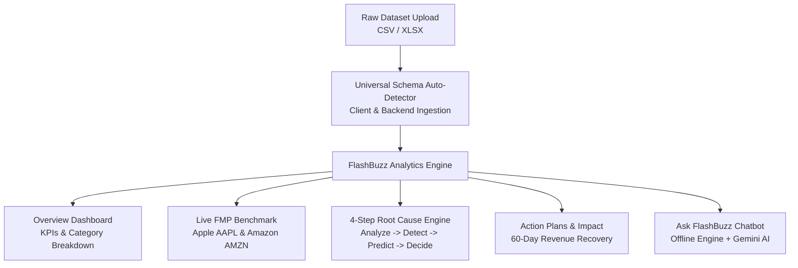

# ⚡ FlashBuzz — AI Autonomous Business Decision Solver

> **Empowering executives and founders with autonomous business intelligence, 4-step root-cause diagnostics, live market benchmarking, and execution-ready decision playbooks.**

[](https://react.dev/)
[](https://www.typescriptlang.org/)
[](https://vitejs.dev/)
[](https://tailwindcss.com/)
[](https://opensource.org/licenses/MIT)

---

## 📌 Executive Summary

Traditional business intelligence tools produce static charts and vanity metrics, leaving executives asking: *"Why did revenue drop, and what exact action should we take today?"*

**FlashBuzz** bridges the gap between raw data analysis and strategic decision execution. When any dataset is connected, FlashBuzz automatically analyzes data health, traces revenue variances down to the exact root cause, projects 60-day financial exposure, benchmarks performance against industry leaders (Apple, Amazon), and deploys prioritized action plans to reclaim lost revenue.

---

## 🌟 Key Features

### 1. 🌐 Universal Multi-Domain Dataset Auto-Detection
- Upload arbitrary business datasets (**CSV** or **Excel**) across any domain: **Healthcare, Retail, SaaS, Groceries, Fashion, Electronics, Logistics, Finance**.
- Intelligent fuzzy schema engine detects transaction dates, revenue/prices, product lines, departments, quantities, discounts, and regional territories without hardcoded schemas.
- Dynamically computes total volume, top-performing segments, underperforming lagging categories, and dormant high-value buyer cohorts.

### 2. 🔍 4-Step Root Cause Diagnostic Engine
Traces high-level revenue symptoms directly to operational causes:
1. **Analyze:** Aggregates transaction performance vs. period benchmarks.
2. **Detect:** Isolates the exact segment, department, or region experiencing demand contraction.
3. **Predict:** Forecasts 60-day downstream revenue erosion if left unmitigated.
4. **Decide:** Prescribes prioritized tactical campaigns with estimated ROI and recovery timelines.

### 3. 📊 Live Competitor & Market Benchmarking (FMP API)
- Real-time market comparison powered by the **Financial Modeling Prep (FMP)** API.
- Benchmarks gross margins, operating margins, and revenue velocity against industry titans (**Apple - AAPL** and **Amazon - AMZN**).
- Gives executives institutional-grade context on operational efficiency.

### 4. 🤖 "Ask FlashBuzz" Executive AI Copilot
- **Dual-Engine Architecture:**
  - **Internal Decision Engine:** Runs client-side deterministic executive analysis offline with 0 latency and 0 external API dependencies.
  - **Live Google Gemini Flash AI:** Seamlessly integrates with Google AI Studio for deep natural language conversational analysis.
- **Typewriter Streaming:** Real-time conversational responses with multi-conversation thread switching.
- **Scenario Pills & Context Inspector:** One-click quick prompts, clickable root-cause navigation links, and transparent active dataset inspection.

### 5. 🎯 Action Plans & Impact Simulation
- Converts insights into step-by-step executable playbooks (e.g. VIP Win-Back Sequences, Ad Spend Optimization, Loyalty Program Launches).
- Interactive before vs. after scenario modeling demonstrating projected revenue uplift and ROI on operational spend.

### 6. 🎨 Senior Executive UX & Design System
- Built with high-contrast executive typography (**Manrope**), refined forest-green accents, accessible button states, and smooth micro-interactions.
- Fully documented design system specification in [`design.md`](./design.md).

---

## 🏗️ System Architecture



---

## 📁 Repository Structure

```text
FlashBuzz/
├── src/
│   ├── App.tsx             # Core application & dynamic decision views
│   ├── main.tsx            # Application entrypoint
│   ├── index.css           # Design tokens, typography & Tailwind CSS v4
│   └── backend/            # Optional Node.js/Express API services
│       ├── server.js       # Express server & API gateway
│       ├── db.js           # MySQL database connection pool
│       └── routes/
│           ├── analysis.js # Server-side data processing & column alias mapper
│           └── auth.js     # User registration & JWT authentication
├── design.md               # Complete FlashBuzz UI/UX design system specification
├── vite.config.ts          # Vite build config with React & Tailwind v4
├── package.json            # Dependencies & build scripts
├── .gitignore              # Ignored paths (dist, node_modules, .env)
└── README.md               # Project documentation
```

---

## 🚀 Quick Start Guide

### Prerequisites
- **Node.js** (v18.0 or newer)
- **npm** or **pnpm**

### 1. Clone the Repository
```bash
git clone https://github.com/abhishek-d-bhat/Flash-Buzz.git
cd Flash-Buzz
```

### 2. Install Dependencies
```bash
npm install
```

### 3. Launch Development Server
```bash
npm run dev
```

Open your browser at **`http://localhost:5173`** to access FlashBuzz.

---

## 🛠️ Build & Verification

To run a strict TypeScript check and build the production bundle:

```bash
# Type-check
npx tsc --noEmit

# Production build
npm run build
```

---

## 🔒 Security & Privacy

- **No Hardcoded Secrets:** FlashBuzz adheres to strict secret management practices. No API keys or credentials are stored in code or Git history.
- **Client-Side Privacy:** Uploaded datasets are processed locally in your browser memory via `localStorage`, ensuring data never leaves your device unless explicitly routed to your private backend.
- **Optional Gemini Integration:** If you wish to use live Google Gemini AI, your key is saved exclusively in your browser's private storage (`flashbuzz_gemini_key`) and is never committed to GitHub.

---

## 👥 Contributors

- **Abhishek D Bhat** ([@abhishek-d-bhat](https://github.com/abhishek-d-bhat))
- **Pranith G** ([@Pranith-g](https://github.com/Pranith-g))

---

## 📄 License

This project is licensed under the MIT License — see the [LICENSE](LICENSE) file for details.
