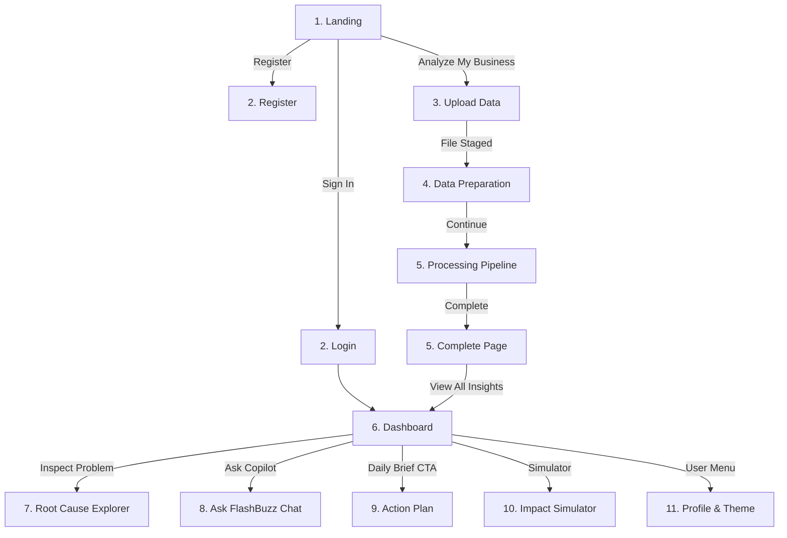

# FlashBuzz UI/UX Design System (`design.md`)

> **Version:** 1.0.0  
> **Target Application:** FlashBuzz — AI Business Intelligence & Growth Copilot  
> **Source Files Reference:** [`FlashBuzz/src/index.css`](file:///c:/Users/Pavan/Documents/Flash-Buzz/FlashBuzz/src/index.css), [`FlashBuzz/src/App.tsx`](file:///c:/Users/Pavan/Documents/Flash-Buzz/FlashBuzz/src/App.tsx), [`FlashBuzz/src/backend/server.js`](file:///c:/Users/Pavan/Documents/Flash-Buzz/FlashBuzz/src/backend/server.js)  
> **Last Updated:** October 2026

---

## Table of Contents
1. [Project Overview](#1-project-overview)
2. [Color Palette](#2-color-palette)
3. [Typography](#3-typography)
4. [Layout and Spacing](#4-layout-and-spacing)
5. [Components and Styling Rules](#5-components-and-styling-rules)
6. [UI/UX Guidelines](#6-uiux-guidelines)
7. [Application Pages and User Flows](#7-application-pages-and-user-flows)
8. [Icons and Visual Assets](#8-icons-and-visual-assets)
9. [Design Tokens and CSS Architecture](#9-design-tokens-and-css-architecture)
10. [Frontend Development Guidelines](#10-frontend-development-guidelines)
11. [Screenshots and Code References](#11-screenshots-and-code-references)
12. [Known Issues and Future Improvements](#12-known-issues-and-future-improvements)

---

## 1. Project Overview

### 1.1 Purpose & Mission
**FlashBuzz** is an intelligent business analytics copilot designed for Indian SMBs, D2C brands, retail merchants, agencies, and startups. Its core mission is to bridge the gap between complex raw data (CSV/Excel sales spreadsheets) and actionable business decisions. 

Instead of requiring business owners to configure complex BI tools, write SQL queries, or parse pivot tables, FlashBuzz ingests multi-sheet spreadsheets, automatically identifies columns and data anomalies, computes core business KPIs, detects root causes behind revenue leaks, forecasts performance, and provides a conversational copilot (**Ask FlashBuzz**) to answer business questions in natural language.

### 1.2 Target Users & Primary User Experience
- **Primary Audience:** Founders, operations directors, e-commerce managers, and small business owners who lack dedicated data analytics teams.
- **Key User Needs:** Immediate time-to-value, clarity without technical jargon, clear loss attribution (identifying why sales dropped and in which channel), and concrete next steps.
- **User Journey Summary:**
  1. **Landing:** Discovers capabilities with interactive teaser cards.
  2. **Auth:** Fast email/password or Google single-click authentication.
  3. **Upload:** Drag-and-drop CSV or Excel sheets up to 25MB.
  4. **Data Preparation:** Real-time data profiling, missing-value audit, duplicate detection, and sheet preview table.
  5. **Processing:** Transparent 7-step AI pipeline with animated status orb.
  6. **Complete:** Overview card summarizing detected losses, opportunities, and gross sales.
  7. **Dashboard:** High-level executive cockpit with AI Daily Brief, interactive revenue charts, and problem rankings.
  8. **Root Cause Explorer:** Multi-node diagnostic flow attributing issues to products, categories, or regions.
  9. **Ask FlashBuzz:** Conversational AI chat with suggestion pills and contextual business memory.
  10. **Action Plan & Impact:** Step-by-step checklist and interactive Before/After simulator.

### 1.3 Design Philosophy & Visual Tone
FlashBuzz embodies an **editorial, warm corporate fintech aesthetic**. It rejects generic dashboard templates in favor of:
- **Earthy, Forest Green Brand Identity:** Grounded in deep greens (`#386641`), fresh growth greens (`#6a994e`), vibrant lime accents (`#a7c957`), and warm cream paper surfaces (`#fbf8f0`, `#f2e8cf`).
- **High-Contrast Editorial Typography:** A combination of geometric, modern headings (**Manrope**) and humanistic body text (**DM Sans**).
- **Tactile Card Architecture:** Soft curved radii (`9px` to `22px`), hairline sage borders (`#dfe6dc`), and deep organic shadows (`0 14px 40px rgba(28, 65, 49, 0.1)`).
- **Proactive AI Feedback:** Pulsing status orbs, live status badges, confidence indicators, and glassmorphic floating insight chips.

---

## 2. Color Palette

The FlashBuzz palette is defined in [`FlashBuzz/src/index.css`](file:///c:/Users/Pavan/Documents/Flash-Buzz/FlashBuzz/src/index.css) under `:root` and supplemented by theme-specific tokens in [`FlashBuzz/src/App.tsx`](file:///c:/Users/Pavan/Documents/Flash-Buzz/FlashBuzz/src/App.tsx).

### 2.1 Core Brand & Base Palette

| Token Name | Hex Code | Visual Sample | Usage & Purpose | Component Examples |
| :--- | :--- | :--- | :--- | :--- |
| `--ink` | `#17362b` | Deep Forest Charcoal | Primary text, main page titles, high-emphasis icons, active states. | Main headings, body copy, active sidebar text. |
| `--green` | `#386641` | Forest Brand Green | Primary brand anchor, primary action buttons, brand logo mark, user chat bubbles. | `.btn-primary`, `.brand-mark`, `.user .bubble`, `.chat-composer .send-btn`. |
| `--green-2` | `#6a994e` | Growth Mid-Green | Secondary brand green, positive trend indicators, active checklist checks, kicker text. | `.page-kicker`, `trend` icon, `.process-step.done`, `.metric.after b`. |
| `--lime` | `#a7c957` | Vibrant Lime Accent | High-visibility attention accent, AI avatar glow, live indicator pulses, active tab highlights. | `.pulse`, `.ai-orb`, `.ai-avatar`, `.sidebar nav button.active` inset border. |
| `--cream` | `#f2e8cf` | Warm Cream Gold | Secondary background tone, warm containers, auth page radial base. | Auth page background, warm container tints. |
| `--cream-soft` | `#fbf8f0` | Soft Ivory Surface | Default application canvas background; soft on the eyes during prolonged review. | `body`, `.soft-bg`, `.landing`, complete screen background. |
| `--white` | `#ffffff` | Pure White Surface | Primary card background, input fields, popover dialogs, high contrast badges. | `.panel`, `.kpi-card`, `.complete-card`, `.auth-card`, inputs. |
| `--border` | `#dfe6dc` | Soft Sage Border | Hairline dividers, card outlines, subtle separation lines. | Card borders, table cell dividers, `.composer-box`. |
| `--muted` | `#6c7d75` | Sage Grey Muted | Secondary text, field placeholders, metadata captions, timestamps. | Captions, subtitle paragraphs, table headers. |
| `--red` | `#bc4749` | Deep Terracotta Red | Critical alerts, financial losses, warning badges, notification pips, danger indicators. | `.alert-icon`, `.problem-card`, `.severity.high`, notification badge. |

### 2.2 Functional & State Colors

| State / Function | Hex Code | Background Tint | Usage Location |
| :--- | :--- | :--- | :--- |
| **Primary Button Hover** | `#2b4f32` | N/A | Darkened green on `.btn-primary:hover` and `.prepare-continue-btn:hover`. |
| **Secondary Button Background** | `#ffffff` | `#edf4eb` (hover) | Light button base with `#264b2d` active text on hover. |
| **Alert / Loss Background** | `#bc4749` (text) | `#fffafa` / `#fae8e6` | `.alert-card`, `.problem-card`, `.count-badge`. |
| **Warning / Medium Severity**| `#a37327` (text) | `#fbf1d8` | `.severity.medium` badges, non-blocking inspection notes. |
| **Opportunity / Growth Tint** | `#6a994e` (text) | `#f0f5e4` / `#eff5df` | `.recommend-card`, `.live-dot`, `.opportunity-dot`. |
| **Dropzone Active State** | `#a7c957` (border)| `#f5f9e8` | `.dropzone:hover`, `.dropzone.dragging` with glowing outline. |
| **Chat Context Notice** | `#386641` (text) | `#edf3e3` (border `#d7e2c8`) | `.context-bar` active dataset notification in Ask FlashBuzz. |

### 2.3 Dark Theme Palette (`[data-theme="dark"]`)
FlashBuzz includes a built-in dark theme toggle stored in `localStorage` (`flashbuzz_theme`):

| Element | Dark Mode Color | Border / Stroke | Note |
| :--- | :--- | :--- | :--- |
| **Page Canvas (`body`, `.complete-page`)** | `#121715` | None | Ultra-deep emerald charcoal canvas. |
| **Cards & Panels (`.auth-card`, `.panel`, `.kpi-card`)** | `#1b211e` | `#303a34` / `#3a443e` | Raised dark emerald container. |
| **Form Inputs & Search Fields** | `#151a17` / `#1b211e` | `#3a443e` | Placeholder: `#78837b`. Disabled: `#252c28`. |
| **Primary Text (`h1`, `h2`, `b`)** | `#f4f6f2` | None | Crisp off-white. |
| **Secondary Text (`p`, `small`)** | `#aeb8b1` | None | Balanced contrast muted grey. |
| **Accent Text & Links** | `#a7c957` | None | High readability lime-green. |

---

## 3. Typography

FlashBuzz imports its typography stack from Google Fonts:
```css
@import url('https://fonts.googleapis.com/css2?family=DM+Sans:wght@400;500;600;700&family=Manrope:wght@500;600;700;800&display=swap');
```

### 3.1 Font Families
1. **Primary Heading Font:** `"Manrope", sans-serif`
   - Used for: Brand logo text, `<h1>`, `<h2>`, `<h3>`, metric numbers, large modal titles.
   - Characteristics: Geometric, crisp, authoritative modern sans-serif.
2. **Body & UI Font:** `"DM Sans", sans-serif`
   - Used for: General body copy, navigation links, buttons, inputs, table contents, chat messages.
   - Characteristics: Clean, highly legible at small sizes, neutral proportions.

### 3.2 Type Scale and Hierarchy

| Level / Class | Font Family | Size | Weight | Line Height | Tracking | Text Color |
| :--- | :--- | :--- | :--- | :--- | :--- | :--- |
| **Hero Display (H1)** | Manrope | `clamp(43px, 5vw, 66px)` | 800 | 1.05 | `-3.6px` | `--ink` (accent span: `--green-2`) |
| **Page Title (H1)** | Manrope | `30px - 34px` | 800 | 1.15 | `-1.5px` | `--ink` |
| **Dashboard Heading (H1)** | Manrope | `23px` | 700 / 800 | 1.2 | `-0.6px` | `--ink` |
| **Section Title (H2)** | Manrope | `21px - 22px` | 800 | 1.25 | `-0.4px` | `--ink` |
| **Card Header (H3)** | Manrope | `14px - 17px` | 700 | 1.3 | Normal | `--ink` |
| **Page Kicker / Eyebrow** | DM Sans | `11px` | 800 | 1.0 | `+1.6px` | `--green-2` (all-caps) |
| **Hero Paragraph** | DM Sans | `18px` | 400 | 1.65 | Normal | `--muted` |
| **Standard Body (`p`)** | DM Sans | `13px - 14px` | 400 | 1.6 | Normal | `--muted` |
| **Button Label (`.btn`)** | DM Sans | `14px` | 700 | 1.0 | Normal | Dependent on variant |
| **KPI Primary Metric (`b`)** | Manrope | `20px - 29px` | 800 | 1.1 | `-0.5px` | `--ink` |
| **Table Cells / Labels** | DM Sans | `12px - 13px` | 500 / 600 | 1.4 | Normal | `--ink` / `--muted` |
| **Micro Caption / Tag** | DM Sans | `7px - 9px` | 800 | 1.0 | `+0.7px - +1px`| `--muted` / `--green-2` (all-caps) |

---

## 4. Layout and Spacing

### 4.1 Page Layout Archetypes

#### 1. Marketing / Landing Page Layout (`.landing`)
- **Nav Header:** Height `82px`, max-width `1200px`, centered with `24px` horizontal padding.
- **Hero Grid:** Two-column CSS grid (`1.02fr .98fr`), `min-height: 680px`, gap `60px`.
- **Hero Visual:** Floating perspective preview card (`415px` wide, rotated `1deg`, layered over a radial lime glow ring).

#### 2. Workflow Centered Layout (`.upload-main`, `.complete-page`, `.processing-page`)
- Standard centered content column: `width: min(720px, calc(100% - 40px))` for Upload; `width: min(1100px, 92%)` for Data Preparation; `width: min(650px, 100%)` for Complete card.
- Floating back navigation button anchored to top-left.
- Generous vertical whitespace (`55px` to `80px` padding).

#### 3. Full-App Dashboard Layout (`.dashboard-layout`)
- **Fixed Sidebar:** Left-docked, fixed position, width `235px` on desktop, background deep forest green (`#294f35`).
- **Main Canvas:** Padded left by `235px`, background soft cream (`#f5f3eb`).
- **Header:** Sticky top header height `98px`, flex alignment between title stack and action controls (Date button, notifications).
- **Dashboard Grid:** Two columns (`1.55fr .8fr`) for charts vs. AI problem ranking list.

#### 4. Dedicated Chat Layout (`.chat-page`)
- **Fixed Sidebar:** Left-docked, width `220px`, dark emerald green (`#294f35`).
- **Sticky Chat Header:** Docked top `66px` height, blurred glass backdrop (`backdrop-filter: blur(10px)`), with left-docked back button, centered title, and close icon.
- **Scrollable Message Canvas:** Max-width `760px` centered messages container with fixed bottom floating input bar (`.chat-composer`).

### 4.2 Spacing & Radii Specifications
- **Base Border Radii:**
  - Micro tags / pills: `4px - 5px`
  - Small badges / buttons / icons: `8px - 10px`
  - Standard cards / panels: `11px - 14px`
  - Large modal dialogs / hero preview cards: `17px - 24px`
  - Full rounded pills: `999px`
- **Box Shadows:**
  - Standard Card Elevation: `--shadow: 0 14px 40px rgba(28, 65, 49, .1)`
  - Floating Chip / Dropzone Elevation: `0 8px 25px rgba(40, 65, 45, .1)`
  - Modal Backdrop Elevation: `0 30px 80px rgba(15, 40, 25, .25)`
  - Button Hover Elevation: `0 8px 20px rgba(56, 102, 65, .2)`

### 4.3 Responsive Breakpoints

FlashBuzz relies on two core CSS media queries:

```css
/* Tablet Breakpoint: 900px */
@media (max-width: 900px) { ... }

/* Mobile Breakpoint: 600px */
@media (max-width: 600px) { ... }
```

| Viewport | Layout Adjustments |
| :--- | :--- |
| **Desktop (> 900px)** | Full 2-column hero, 235px sidebar with full labels, 4-column KPI grid, 2-column dashboard grid. |
| **Tablet (601px - 900px)** | Hero stacks vertically; landing navigation links hide; sidebar collapses to an icon-only dock (`72px` width); KPI grid shifts to 2 columns (`1fr 1fr`); dashboard grid collapses to single column. |
| **Mobile (≤ 600px)** | Sidebar converts from vertical left rail to a fixed bottom navigation bar (`height: 62px`); chat sidebar is hidden; action buttons in Data Prep stack in reverse order (`column-reverse`); hero visual scales down (`scale(0.78)`); date picker hidden. |

---

## 5. Components and Styling Rules

### 5.1 Buttons

FlashBuzz implements a reusable `<Button>` and `<BackButton>` pattern with explicit hover, active, and accessible focus states.

```tsx
// FlashBuzz Button Component Signature
<Button variant="primary" onClick={handleClick}>Label</Button>
<BackButton onClick={handleBack} label="Back to Upload" />
```

#### 1. Primary Action Button (`.btn-primary`, `.prepare-continue-btn`)
- **Appearance:** Solid forest green background (`#386641`), pure white bold text (`#ffffff`), border radius `10px`, min-height `44px - 46px`, padding `0 20px - 24px`.
- **States:**
  - *Default:* `background: #386641; color: #ffffff;`
  - *Hover:* `background: #2b4f32; transform: translateY(-2px); box-shadow: 0 8px 22px rgba(43, 79, 50, 0.28);`
  - *Active:* `transform: translateY(0);`
  - *Focus-Visible:* `outline: 2px solid var(--green-2); outline-offset: 2px;`
  - *Disabled:* `opacity: 0.55; cursor: not-allowed; transform: none;`

#### 2. Secondary & Back Buttons (`.btn-secondary`, `.back-btn`, `.prepare-back-btn`, `.chat-back-btn`)
- **Appearance:** Crisp white background (`#ffffff`), distinct forest green border (`1.5px solid #386641`), dark green text (`#386641`), min-height `38px - 46px`, flex aligned with left arrow `<Icon name="arrow-left" size={15} />`.
- **States:**
  - *Default:* `background: #ffffff; border: 1.5px solid #386641; color: #386641;`
  - *Hover:* `background: #edf4eb; color: #264b2d; border-color: #264b2d; transform: translateY(-1px); box-shadow: 0 4px 14px rgba(56, 102, 65, 0.16);`
  - *Active:* `transform: translateY(0);`
  - *Focus-Visible:* `outline: 2px solid #386641; outline-offset: 2px;`

#### 3. Icon Buttons (`.icon-btn`)
- Size: `40px × 40px`, borderless, transparent background.
- Hover: Soft sage tint (`#edf2e9`), border-radius `9px`.

### 5.2 Form Inputs, Dropzones, and Controls

#### 1. File Upload Dropzone (`.dropzone`)
- **Dimensions:** Min-height `285px`, border: `1.5px dashed #9db18f`, border-radius `17px`, background `var(--white)`.
- **Hover & Dragging:** Border color changes to `--lime` (`#a7c957`), background becomes `#f5f9e8`, soft box-shadow `0 0 0 5px rgba(167, 201, 87, 0.13)`, scale `1.01`.
- **Centerpiece:** Centered circular icon container (`.upload-orbit`, `62px × 62px`, background `#eff4e2`).

#### 2. Text Inputs & Textareas
- Height: `44px` for single-line text inputs; `min-height: 60px` for composer textareas.
- Border: `1px solid #ced9cd`, border-radius `10px - 12px`, padding `0 14px`.
- Typography: `"DM Sans"`, `14px`, color `--ink`.
- Placeholder: Color `#9aa59e`.
- Focus State: Border color `#386641`, subtle green glow.

### 5.3 Cards & Data Containers

#### 1. KPI Metric Card (`.kpi-card`)
- Layout: 2-column grid (`1fr auto`), min-height `124px`, padding `16px`.
- Elements: Top-left icon (`34px × 34px`, background `#eff4e6`), top-right metric label (`small`), bottom-left large value (`b`, `20px`), bottom-right delta percentage (`em`, `+12.4%` green or `-3.2%` red).
- Interactive Drawer (`.kpi-extra`): Absolute positioned bottom drawer that slides up on card hover (`transform: translateY(0)`).

#### 2. Problem Ranking Card (`.problem-card`)
- Appearance: Light red surface (`#fffafa`), bordered in blush red (`#edcfcd`), border-radius `10px`, padding `14px`.
- Badges: Severity pill (`.severity.high` in red, `.severity.medium` in amber).
- Impact Line: Bottom border with financial loss figure formatted in red (`b`).

#### 3. Data Profiling Table (`PrepareData`)
- Container: Horizontal scrollable card, border `1px solid var(--border)`, border-radius `12px`.
- Header: Light background (`#f6f8f4`), font-weight `700`, uppercase micro-text.
- Rows: Padding `12px 14px`, hairline bottom border (`1px solid var(--border)`). Missing value percentages formatted with 2 decimal points.

### 5.4 Steppers & Feedback Badges
- **Inspection Stepper (`.stepper`):** Sequence of numbered circular pills (`25px × 25px`) joined by hairline connecting bars (`.stepper i`, `45px × 1px`). Active step turns `--green` with white numeral.
- **Toasts (`.toast`):** Floating fixed toast at bottom-right (`right: 25px; bottom: 24px`), border-radius `9px`, shadow `--shadow`, with a `3px` solid green or red accent bar on the left edge.

### 5.5 Chat Interface Components (`Ask FlashBuzz`)
- **Context Banner (`.context-bar`):** Green-tinted pill banner (`#edf3e3`) showing currently loaded file and sheet context with an interactive "Change context" trigger.
- **Message Bubbles:**
  - *AI Message (`.bubble`):* White background, border `1px solid var(--border)`, border-radius `4px 12px 12px 12px` (notched top-left corner), sender tag in `--green-2`.
  - *User Message (`.user .bubble`):* Solid forest green (`var(--green)`), pure white text, border-radius `12px 4px 12px 12px` (notched top-right corner).
- **Typing Indicator (`.typing`):** Three animated pulsing dots bouncing sequentially using `@keyframes dots`.
- **Suggestion Chips (`.suggestions button`):** Horizontally scrollable row of rounded pills (`border-radius: 999px`) offering pre-built business questions.

---

## 6. UI/UX Guidelines

### 6.1 Visual Hierarchy & Information Prioritization
1. **Primary Metric First:** Every screen leads with either a single macro takeaway (e.g., "Your business analysis is ready", "Total Revenue ₹82.4L") before exposing granular tables or sub-metrics.
2. **Loss-Aversion Framing:** Business issues requiring immediate intervention are styled with terracotta red badges and ranked by revenue impact.
3. **Growth Second:** Positive trends and expansion opportunities are styled in growth mid-green (`#6a994e`) and accent lime.

### 6.2 Navigation Consistency & Back Buttons
- Every secondary screen (`prepare`, `processing`, `complete`, `root`, `chat`, `action`, `impact`, `profile`) must provide an unambiguous, visible route back to the preceding screen or main dashboard.
- Back buttons adhere strictly to the **Secondary Button Pattern**: light/white background, green border, dark green text, left-arrow icon. They must never be rendered as low-contrast plain text or unstyled links.

### 6.3 Data Visualization & Number Formatting
FlashBuzz formats metrics using the Indian numbering system (`Lakhs` and `Crores`) for familiarity with the target audience:
```ts
// Canonical formatting rule in FlashBuzz
const formatCurrency = (value: number) => {
  if (Math.abs(value) >= 10000000) return `₹${(value / 10000000).toFixed(2)}Cr`;
  if (Math.abs(value) >= 100000)   return `₹${(value / 100000).toFixed(2)}L`;
  return `₹${value.toLocaleString("en-IN", { maximumFractionDigits: 2 })}`;
};
```
Percentages must always include an explicit sign prefix (`+12.4%` or `-8.1%`) and match the semantic color tokens (`--green-2` or `--red`).

### 6.4 Accessibility & Contrast
- **Text Contrast:** All critical body text utilizes `--ink` (`#17362b`) on cream (`#fbf8f0`), guaranteeing a contrast ratio exceeding `10:1` (WCAG AAA).
- **Focus Rings:** All interactive buttons and inputs implement `:focus-visible` with a 2px outline and 2px offset in `--green` or `--green-2`.
- **No Reliance on Color Alone:** Severity badges accompany color with explicit text labels ("HIGH", "MEDIUM", "LOW"); trend values accompany color with explicit `+` or `-` characters and directional SVG icons.

---

## 7. Application Pages and User Flows

FlashBuzz is structured as a client-side state machine in [`FlashBuzz/src/App.tsx`](file:///c:/Users/Pavan/Documents/Flash-Buzz/FlashBuzz/src/App.tsx) governed by the `Screen` type:

```ts
type Screen =
  | "landing"    // Public marketing hero & product preview
  | "login"      // User sign-in
  | "register"   // User registration
  | "upload"     // File upload dropzone
  | "prepare"    // Dataset profiling & preview
  | "processing" // 7-step AI computation pipeline
  | "complete"   // Summary & analysis gate
  | "dashboard"  // Core analytics overview & chart
  | "root"       // Root cause breakdown
  | "chat"       // Ask FlashBuzz copilot
  | "action"     // AI Action plan checklist modal
  | "impact"     // Before/After scenario simulator
  | "profile";   // Account settings & theme toggle
```

### 7.1 Detailed Screen Specifications



#### 1. Landing Page (`Landing`, line 221)
- **Header:** Sticky landing nav with Brand mark, anchor links (*How it works*, *AI insights*, *Security*), and Auth trigger (*Sign in* or *Profile*).
- **Hero Section:** High-impact heading with split color, subtitle, CTA button (*Analyze my business*), and secondary play demo link.
- **Hero Visual:** Angled 3D preview card showcasing live revenue, profit, an AI detected alert card, and floating animated metric chips.
- **Client Logo Strip:** Subdued industry badges (Retail, D2C Brands, Agencies, Startups, Small Business).

#### 2. Authentication Pages (`Login` line 669 & `Register` line 854)
- **Container:** Centered card (`width: min(460px, 100%)`) on warm cream gradient backdrop.
- **Controls:** Green brand icon mark, H1 heading, email/password fields, single-click Google OAuth button, remember me checkbox, and link to switch between login and register.

#### 3. Upload Page (`Upload`, line 1092)
- **Header:** Simple header with Brand mark and numbered 3-step pipeline stepper.
- **Dropzone:** Large dashed upload boundary supporting `.csv`, `.xlsx`, `.xls` up to 25MB.
- **Staged File Card:** Shows file name, byte size, detected file type icon, removal trigger, and "Analyze Now" button.

#### 4. Data Preparation Page (`PrepareData`, line 1475)
- **Header:** Persistent `<BackButton>` and `<Brand>` header.
- **KPI Summary Grid:** 4 tiles detailing Total sheets, Rows in selected sheet, Columns detected, and Preview records.
- **Sheet Selector Tabs:** Multi-tab pill selector for workbooks containing multiple sheets.
- **Data Quality Alert:** Yellow or green inspection card reporting duplicate rows removed, empty rows skipped, and null cell counts.
- **Data Profiling Table:** Tabular listing of all detected columns, data types (string, number, date), null counts, and missing percentages.
- **Sample Preview Grid:** Horizontal scrolling table showing raw data records.
- **Action Bar (`.prepare-actions`):** Responsive flex bar housing the secondary `prepare-back-btn` ("Back to Upload") and primary `prepare-continue-btn` ("Continue to Analysis").

#### 5. Processing & Analysis Complete (`Processing` line 1852 & `Complete` line 2013)
- **Processing:** Radial glowing AI orb, step-by-step 7-phase checklist with animated spinners and progress fill bar.
- **Complete:** Glassmorphic card displaying large green checkmark, count of detected loss findings, growth opportunities, gross revenue analyzed, and "View All Insights" primary CTA.

#### 6. Business Dashboard (`Dashboard`, line 2937)
- **Sidebar:** Fixed left navigation with brand mark, active workspace indicator, route buttons with badge counters, data sync pulse, and user profile pill.
- **AI Daily Brief:** High-contrast forest gradient banner synthesizing the top daily priority and direct button to the Action Plan.
- **KPI Metrics Grid:** 4 interactive cards (Revenue, Gross Margin, Active Customers, At-Risk Accounts).
- **Revenue Line Chart:** Interactive SVG chart with period filters (7D, 30D, 90D, 1Y), smooth bezier curves, gradient fill, and interactive node tooltips.
- **AI Problem Ranking:** Prioritized cards detailing financial loss, severity rating, and click-to-expand diagnostic triggers.

#### 7. Root Cause Explorer (`RootCause`, line 3190)
- **Diagnostic Flowchart:** Interactive node sequence (`.cause-flow`) connecting business symptom -> diagnostic factor -> root cause.
- **Evidence Panel:** Right-hand rail displaying confidence score, statistical proof checklist, and recommended remediation.

#### 8. Ask FlashBuzz AI Chat (`Chat`, line 3398)
- **Sidebar:** History list of past business questions and "New Chat" trigger.
- **Sticky Glass Header:** Prominent secondary back button, centered title with live AI status dot, and close button.
- **Conversation Canvas:** Chronological message list, smart question suggestion chips, and bottom composer box with file attachment trigger and send button.

#### 9. Action Plan & Impact Simulator (`ActionPlan` line 3662 & `Impact` line 3800)
- **Action Plan:** Modal checklist detailing tasks required to recover lost revenue, percentage progress bar, and completion celebration banner.
- **Impact Simulator:** Interactive Before vs. After revenue projection calculator showing anticipated recovery amounts upon completing recommendations.

#### 10. Profile & Settings (`Profile`, line 2157)
- Account credentials, business metadata, and Light / Dark Theme selector.

---

## 8. Icons and Visual Assets

FlashBuzz does not load third-party icon fonts or heavy external packages. It implements an internal, zero-dependency SVG component: `<Icon name={IconName} size={number} />`.

### 8.1 The 19 Built-in Icons

```tsx
type IconName =
  | "bolt"       // FlashBuzz brand lightning bolt
  | "arrow"      // Directional forward / CTA arrow
  | "arrow-left" // Back navigation arrow
  | "upload"     // File upload tray with upward arrow
  | "file"       // Document / spreadsheet page icon
  | "check"      // Verification checkmark
  | "close"      // Modal / dismiss cross
  | "eye"        // Data preview / view trigger
  | "chart"      // Bar chart analytics icon
  | "users"      // Customer / user cohort icon
  | "wallet"     // Revenue / financial wallet icon
  | "alert"      // Triangular warning & problem alert
  | "spark"      // AI intelligence sparkle
  | "send"       // Chat message submission paper plane
  | "clip"       // Attachment paperclip
  | "search"     // Magnifying glass search tool
  | "target"     // Goal / precision target
  | "trend"      // Upward growth line chart
  | "calendar"   // Date range picker icon
  | "chevron";   // Disclosure / card forward chevron
```

### 8.2 Icon Rendering Rules
- **ViewBox:** All icons are drawn on a uniform `24 × 24` grid.
- **Stroke System:** Standard `strokeWidth="1.8"`, `strokeLinecap="round"`, `strokeLinejoin="round"`, and `fill="none"`.
- **Color Inheritance:** Icons use `stroke="currentColor"` to automatically adapt to parent container colors.
- **Accessibility:** All icons render with `aria-hidden="true"`; interactive icon buttons must have explicit `aria-label` tags.

### 8.3 Brand Marks & Logos
- **Primary Brand Mark (`.brand-mark`, `.mini-logo`):**
  - Dimensions: `34px × 34px` (or `25px × 25px` for mini).
  - Background: Forest Green (`#386641`).
  - Shape: Asymmetric squircle with `border-radius: 9px 9px 9px 3px` (notched bottom-left corner).
  - Foreground: White lightning bolt (`<Icon name="bolt" size={19} />`).
- **Brand Light Variant (`.brand-light`):**
  - Used on dark sidebars. Background becomes vibrant lime (`#a7c957`) with forest green bolt icon.

---

## 9. Design Tokens and CSS Architecture

### 9.1 Design Token Reference Table

The following table cross-references the tokens currently defined in the FlashBuzz codebase with standard design system aliases:

| System Token Alias | Existing Code Token | Current Value | Scope / Location |
| :--- | :--- | :--- | :--- |
| `--color-primary` | `--green` | `#386641` | `:root` in `index.css` |
| `--color-primary-hover`| *(inline hex)* | `#2b4f32` | `.prepare-continue-btn:hover` |
| `--color-secondary` | `--green-2` | `#6a994e` | `:root` in `index.css` |
| `--color-accent` | `--lime` | `#a7c957` | `:root` in `index.css` |
| `--color-background` | `--cream-soft` | `#fbf8f0` | `:root` in `index.css` |
| `--color-surface` | `--white` | `#ffffff` | `:root` in `index.css` |
| `--color-surface-muted`| `--cream` | `#f2e8cf` | `:root` in `index.css` |
| `--color-text` | `--ink` | `#17362b` | `:root` in `index.css` |
| `--color-text-muted` | `--muted` | `#6c7d75` | `:root` in `index.css` |
| `--color-danger` | `--red` | `#bc4749` | `:root` in `index.css` |
| `--color-border` | `--border` | `#dfe6dc` | `:root` in `index.css` |
| `--shadow-card` | `--shadow` | `0 14px 40px rgba(28, 65, 49, .1)` | `:root` in `index.css` |
| `--font-heading` | *(font-family)* | `"Manrope", sans-serif` | Global headings in `index.css` |
| `--font-body` | *(font-family)* | `"DM Sans", sans-serif` | Global `body` in `index.css` |
| `--radius-sm` *(Proposed)* | *(hardcoded)* | `8px - 9px` | Buttons, tags, avatars |
| `--radius-md` *(Proposed)* | *(hardcoded)* | `10px - 14px` | Standard cards, panels |
| `--radius-lg` *(Proposed)* | *(hardcoded)* | `17px - 24px` | Hero cards, modals |
| `--spacing-xs` *(Proposed)* | *(hardcoded)* | `4px - 8px` | Badge padding, micro gaps |
| `--spacing-sm` *(Proposed)* | *(hardcoded)* | `10px - 14px` | Button padding, card gaps |
| `--spacing-md` *(Proposed)* | *(hardcoded)* | `16px - 24px` | Card internal padding |
| `--spacing-lg` *(Proposed)* | *(hardcoded)* | `32px - 48px` | Section margins, hero padding |

### 9.2 CSS Architecture & Cascade Hierarchy
FlashBuzz combines Tailwind CSS v4 directives with customized semantic vanilla CSS:
1. **Reset & Imports:** Google Fonts and `@import 'tailwindcss';` loaded at head of [`FlashBuzz/src/index.css`](file:///c:/Users/Pavan/Documents/Flash-Buzz/FlashBuzz/src/index.css).
2. **Global CSS Custom Properties:** Centralized in `:root` (lines 4–16).
3. **Core Utility & Component Classes:** Layout structures (`.landing`, `.dashboard-layout`, `.chat-page`), buttons (`.btn`, `.back-btn`), and typography rules.
4. **Scoped Dynamic Theme Overrides:** Managed in [`FlashBuzz/src/App.tsx`](file:///c:/Users/Pavan/Documents/Flash-Buzz/FlashBuzz/src/App.tsx) under `AuthStyles` and the root `<App />` theme injector to support real-time dark/light mode toggling via `document.documentElement.setAttribute("data-theme", theme)`.

---

## 10. Frontend Development Guidelines

To ensure interface consistency across all frontend contributions, developers must adhere to the following rules:

### 10.1 Golden Rules for Developers
1. **Never Invent Colors:** Always utilize the CSS variables (`var(--green)`, `var(--lime)`, `var(--ink)`, `var(--cream-soft)`, `var(--red)`, `var(--border)`). Never introduce arbitrary blues, purples, or uncalibrated greys.
2. **Preserve the Dual-Font Pairing:** All headings (`h1`–`h3`), brand text, and numeric callouts must use `"Manrope"`. All labels, buttons, inputs, and paragraphs must use `"DM Sans"`.
3. **Always Support Back-Navigation:** Any newly introduced page or modal must include a clearly visible `<BackButton>` using the secondary button styling:
   ```tsx
   <BackButton onClick={() => go("dashboard")} label="Back to Dashboard" />
   ```
4. **Buttons Must Follow the Established Variants:**
   - Primary: `<Button variant="primary">Label</Button>`
   - Secondary: `<Button variant="secondary">Label</Button>`
   - Do not override button styles with ad-hoc colors unless implementing an approved semantic action (e.g., delete/danger).
5. **Format Business Figures Consistently:** Use the central Indian currency formatting convention (`₹...L`, `₹...Cr`) and always include signed percentage deltas.
6. **Maintain Mobile Breakpoint Parity:** When building new panels or forms, verify layout behavior at `≤ 900px` (tablet) and `≤ 600px` (mobile). Container widths must never cause horizontal scrolling.
7. **Ensure Keyboard and Screen Reader Accessibility:** Use semantic HTML (`<button>`, `<main>`, `<nav>`), retain visible focus outlines, and accompany pure icon triggers with descriptive `aria-label` attributes.

---

## 11. Screenshots and Code References

### 11.1 Key Project Code Files
| File Path | Description & Role |
| :--- | :--- |
| [`FlashBuzz/src/index.css`](file:///c:/Users/Pavan/Documents/Flash-Buzz/FlashBuzz/src/index.css) | Core design system tokens (`:root`), base element resets, responsive media queries, and component styles. |
| [`FlashBuzz/src/App.tsx`](file:///c:/Users/Pavan/Documents/Flash-Buzz/FlashBuzz/src/App.tsx) | Complete React application source code: Screen state machine, SVG icon library, screen layouts, and dark theme definitions. |
| [`FlashBuzz/src/backend/server.js`](file:///c:/Users/Pavan/Documents/Flash-Buzz/FlashBuzz/src/backend/server.js) | Backend Express engine providing CSV/Excel ingestion, data profiling, sales analysis, and the AI copilot endpoint. |
| [`FlashBuzz/package.json`](file:///c:/Users/Pavan/Documents/Flash-Buzz/FlashBuzz/package.json) | Frontend dependencies (React 19, Vite, Tailwind CSS v4, Lucide React). |

### 11.2 Visual Inspection Artifacts
- **Data Preparation Screen:** Shows multi-card KPI bar, data quality status card, column profile table with detection metrics, and primary/secondary button navigation.
- **Ask FlashBuzz Chat Screen:** Shows fixed dark emerald sidebar, blurred sticky header with prominent secondary back button, green user bubbles, white AI responses, and suggestion chips.
- **Analysis Complete Screen:** Confirms the 3-metric summary grid (loss findings, product/region opportunities, total sales) with dynamic Indian currency formatting.

---

## 12. Known Issues and Future Improvements

### 12.1 Current Implementation State
- The design system features a distinctive aesthetic with consistent color palettes, typography, and responsive support across desktop and mobile.
- All core user journeys from upload to AI recommendations are fully styled and functional.

### 12.2 Known Inconsistencies & Issues Discovered
1. **Inline Styles vs. CSS Classes in Data Preparation:** In [`FlashBuzz/src/App.tsx`](file:///c:/Users/Pavan/Documents/Flash-Buzz/FlashBuzz/src/App.tsx) (lines 1550–1810), the `PrepareData` screen uses several inline `style={{ ... }}` blocks for grids and padding rather than class names from `index.css`.
2. **Duplicated Theme Styles:** Dark mode styles are injected dynamically via a `<style>` string inside `App.tsx` rather than compiled directly in `index.css`.
3. **Hardcoded Radius & Spacing Values:** While colors are tokenized in `:root`, radius and spacing tokens (`--radius-card`, `--spacing-md`) are applied as ad-hoc pixel values across different rules.

### 12.3 Recommended Future Improvements
1. **Refactor Inline Styles to CSS Modules / Utility Classes:** Migrate inline styling in `PrepareData` to named classes in `index.css` (`.prep-summary-grid`, `.prep-card`, `.prep-table-wrapper`).
2. **Formalize Spacing and Radius Tokens:** Add the proposed design tokens (`--radius-sm`, `--radius-md`, `--radius-lg`, `--spacing-sm`, `--spacing-md`, `--spacing-lg`) directly to `:root` in `index.css`.
3. **Centralize Dark Theme Variables:** Replace `[data-theme="dark"]` stylesheet injections with native CSS variable remapping under `:root[data-theme="dark"]`.
4. **Consolidate Icon Sizing Tokens:** Establish standard icon size utility classes (`.icon-sm: 14px`, `.icon-md: 18px`, `.icon-lg: 24px`) to standardize visual proportions across custom components.

---

*This document serves as the official frontend UI/UX standard for FlashBuzz. Developers must reference and preserve these design rules during feature additions or bug fixes.*
